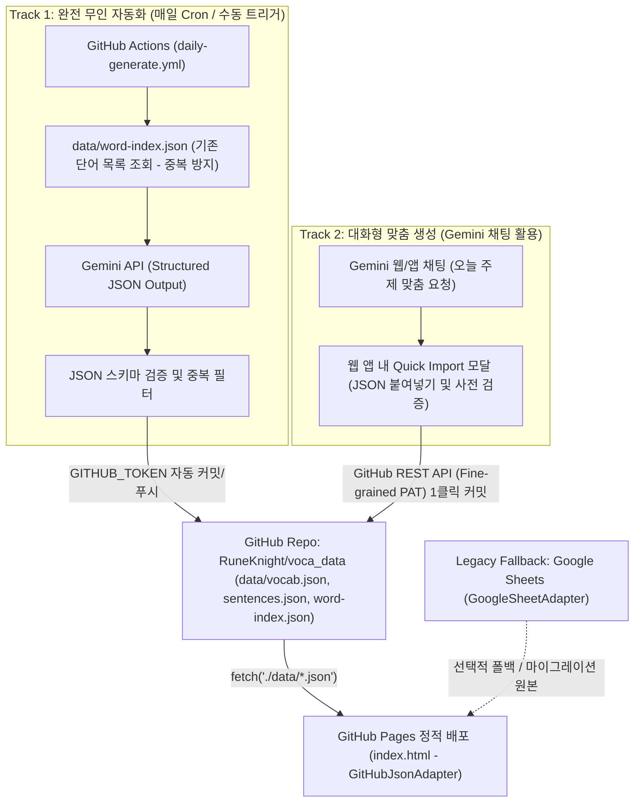
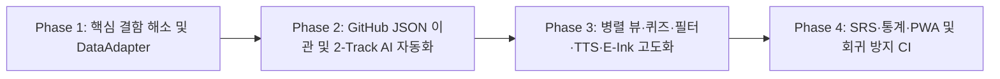

# 🚀 Language Hub Pro (`voca_data`) 프로젝트 분석 및 비파괴 고도화 계획서 (v2 — GitHub Repo JSON + AI 자동화 아키텍처)

> **목적**: 현재 운영 중인 `Language Hub Pro`의 코드베이스와 Gemini 기반 수동 학습 데이터 운영 흐름을 정밀 분석하고, **기존의 모든 기능·학습 기록·UX를 전혀 해치지 않으면서(Zero-Regression / Non-Breaking)** 저장소를 **GitHub Repo JSON + 앱 내 Quick Import + GitHub Actions(Gemini API) 자동화** 구조로 고도화하는 실행 계획을 정의합니다.
>
> **분석 기준**: `main` 브랜치 (`00207d0`, PR #1~#6 반영 상태) — `index.html` (1,312 lines), `README.md`

---

## 0. 비파괴 고도화 5대 원칙 (Non-Breaking Principles)

본 계획서의 모든 개선 항목은 아래 5가지 원칙을 필수 제약 조건으로 준수합니다.

1. **기존 데이터 100% 무손실 승계 및 병행 호환**: `DataAdapter` 계층을 도입하여 기존 Google Sheets(`VOCAB_GID: 0`, `SENTENCE_GID: 765046051`) 로더를 즉시 삭제하지 않고 폴백/병행 어댑터로 유지하며, 기존 시트 데이터는 1회 마이그레이션 스크립트로 신규 JSON 포맷에 무손실 이관합니다.
2. **`localStorage` 기존 키 완전 보존**: 사용자 브라우저에 저장된 기존 키(`vh_vocabData`, `vh_sentenceData`, `vh_lastSync`, `vh_bookmarks`, `vh_mastered`, `vh_darkMode`, `vh_eInkMode`, `vh_vocabLayout`)를 유지하고, 기존 키 포맷(`Language:Word`)과 신규 안정 `id` 간 자동 호환 브릿지를 제공합니다. 신규 기능은 독립 키(`vh_ttsRate`, `vh_srs`, `vh_studyLog`, `vh_ghConfig` 등)로만 확장합니다.
3. **Zero-Build & 100% 무료 정적 배포 유지**: 별도 백엔드 서버나 프론트엔드 빌드 과정 없이 GitHub Pages 및 로컬 브라우저에서 즉시 실행되는 경량 구조를 유지합니다.
4. **기존 UX 기본 동작 보존 (Opt-in 확장)**: 단어 카드(카드형/리스트형), 학습 문장, 퀴즈, 다크 모드, E-Ink 모드의 기존 기본 동작을 그대로 유지하고, 병렬 뷰·Quick Import·SRS·통계 등 신규 기능은 선택적(Opt-in) UI로 통합합니다.
5. **독립 PR 단위 점진적 적용 및 자동 검증**: 모든 변경은 작은 PR 단위로 분할 배포·롤백이 가능하며, 데이터 스키마 검증과 Playwright 회귀 테스트로 기존 기능 보호를 자동화합니다.

---

## 1. 현재 프로젝트 및 워크플로우 분석 (As-Is Analysis)

### 1.1 현재 아키텍처 및 기능 현황

| 영역 | 현재 구현 방식 | 주요 강점 |
| :--- | :--- | :--- |
| **구조 / 배포** | 단일 `index.html` (1,312줄), Tailwind CSS CDN, Vanilla JS | 빌드/설치 없이 즉시 실행 및 GitHub Pages 무료 배포 가능 |
| **데이터 연동** | Google Sheets GViz JSONP (`loadGvizData`) + `localStorage` 캐시 | 서버리스 헤드리스 CMS, 재방문 시 캐시 선렌더링 |
| **단어 학습 (`vocab`)** | 3D 플립 카드형 / 리스트형 전환, 독일어 관사(`der`/`die`/`das`) 컬러 코딩 | 시각 연상 기반 암기 및 기기별 레이아웃 유연성 |
| **문장 학습 (`sentence`)** | `<details>` 기반 3초 인출(Active Recall) 아코디언 토글 | 해석을 가리고 능동적 회상을 유도하는 깔끔한 UX |
| **퀴즈 (`quiz`)** | 단어/문장 4지선다 10문항 + 정/오답 시각 피드백 | 별도 도구 없이 즉시 자가 테스트 가능 |
| **필터 / 탐색** | 언어, 품사(`posFilterSelect`), New만 보기, 즐겨찾기, 학습 완료 숨기기, 검색, 셔플, 페이지네이션(10~50) | 다차원 조건 조합으로 집중 복습 지원 |
| **테마 / 디바이스** | 라이트 / 다크 모드 + 전자잉크(E-Ink) 고대비 무애니메이션 모드 | 전자책 리더기부터 데스크톱/모바일 환경까지 대응 |
| **음성 (TTS)** | Web Speech API (`en-US`, `de-DE`, `rate = 0.9`) | 무과금 네이티브 발음 즉시 재생 |

### 1.2 실제 콘텐츠 생성 워크플로우 진단 (Gemini TSV → Google Sheets)

현재 운영 중인 Gemini 출력 형태(날짜 + `English A2-B1` / `German B1-B2` TSV 코드 스니펫)를 분석한 결과 다음과 같은 핵심 특성과 병목이 확인되었습니다.

- **발견된 긍정적 학습 패턴**:
  - **영↔독 병렬 주제 구성**: 동일 날짜 배치에서 영어(`A2-B1`)와 독일어(`B1-B2`) 문장이 같은 상황(예: 빌드 파이프라인 스키마 검증, 금요일 체크리스트, 동네 서점, 접이식 자전거 정비, 프로덕션 퇴근)으로 1:1 매칭됨.
  - **범위형 CEFR 레벨**: `A2-B1`, `B1-B2`처럼 구간 문자열이 실제 데이터에 사용됨.
  - **개인화 도메인 주제**: 업무/개발(`dev`), 일상(`daily`), 취미(`cycling`) 등 맥락이 뚜렷함.
- **현재 TSV + Google Sheets 방식의 병목**:
  1. **수동 복사·붙여넣기 반복**: 매번 Gemini 응답을 복사해 구글 시트의 단어/문장 탭을 오가며 붙여넣어야 함.
  2. **중복 제어 불가**: 기존에 이미 학습한 단어·표현이 무엇인지 Gemini가 모르기 때문에 중복 생성이 발생하기 쉬움.
  3. **평면(Flat) 스키마 한계**: 영↔독 병렬 쌍 연결, 문장↔핵심 단어 연결, 독일어 복수형, 품사/성별 분리, 빈칸 퀴즈용 핵심 구문(`cloze`) 등을 표현하기 어려움.
  4. **특수문자 파싱 취약**: TSV 탭·줄바꿈·따옴표가 시트 붙여넣기 및 JSONP 렌더링 과정에서 깨질 위험 존재.

### 1.3 코드 정밀 진단 — 발견된 잠재 결함 (`index.html`)

| # | 영역 | 발견 내용 (코드 근거) | 영향 및 문제점 |
| :---: | :--- | :--- | :--- |
| **1** | **셔플 로직 결함** | `renderVocab()` (L817-819), `renderSentences()` (L977-979)에서 `filtered.sort(() => Math.sin(filtered.length) - 0.5)` 사용 (`shuffledVocabIndices` L378 미사용) | 고정 상수 반환으로 인해 실제 무작위 셔플이 동작하지 않음 |
| **2** | **인라인 핸들러 이스케이프 한계** | `escapeJsParam()` (L397-403) + 인라인 `onclick` 혼용, 퀴즈 `data-opt`(`escapeHtml`) vs 인자(`escapeJsParam`) 불일치 | 줄바꿈·따옴표·특수문자 포함 데이터에서 TTS/북마크 오류 또는 퀴즈 오판 가능 |
| **3** | **로딩 타임아웃·리소스 누수** | `loadGvizData()` (L550-591), `checkAllLoaded()` (L437-444)에 타임아웃/부분 실패 복구 및 `onerror` 정리 누락 | 한쪽 시트 실패 시 스켈레톤 무한 대기, 수동 동기화 버튼 부재 |
| **4** | **미사용 외부 라이브러리** | L17에 `papaparse@5.4.1` CDN 로드되나 코드 내 미사용 | 불필요한 네트워크 요청 및 초기 로딩 지연 |
| **5** | **품사 분류 오탐 가능성** | `getPosCategory()` (L645-664)의 `includes('der')`/`'die'`/`'das'` 부분 문자열 매칭 | 품사 표기 내 일반 단어와 겹칠 경우 명사 오분류 가능 |
| **6** | **퀴즈 모드 완성도 갭** | `startQuiz()`~`checkQuizAnswer()` (L1065-1236)에 필터 연동·오답 노트(`README.md` 표기와 불일치)·빈 의미 방어 부재 | 틀린 문제 재학습 및 조건별 맞춤 출제 불가 |
| **7** | **검색·필터 UX 디테일** | `handleSearch()` (L759-763) 디바운스 부재, 레벨(`A2-B1` 등)·주제·정렬 필터 및 필터 초기화 버튼 부재 | 데이터 증가 시 입력 지연, 복합 필터 해제 번거로움 |
| **8** | **TTS 유연성 부족** | `speakText()` (L594-605)에서 속도 `0.9` 고정, 음성 선택 및 연속 듣기 미지원 | 학습자 수준별 속도/음성 조절 및 쉐도잉 청취 불가 |
| **9** | **E-Ink & 키보드 접근성** | `goToPage()` (L774)가 E-Ink 모드에서도 `behavior: 'smooth'` 수행, 키보드/페이지 터너 단축키 및 `aria-*` 부족 | E-Ink 화면 잔상(Ghosting) 유발 및 리모컨/키보드 탐색 불편 |
| **10** | **단일 기기 종속 및 회귀 위험** | `localStorage` 단독 저장, `getItemKey()`가 단어 텍스트에 종속, 자동화 회귀 테스트 부재 | 기기 이동 시 기록 유실, 철자 수정 시 북마크 끊김, UI 회귀 위험 상존 |
| **11** | **문서-코드 불일치** | `README.md`에 E-Ink 모드, 리스트형 뷰, 품사 필터, 문장 퀴즈 등 최신 기능 미반영 | 문서 신뢰도 저하 |

---

## 2. 선택지 A 목표 아키텍처: GitHub Repo JSON + 2-Track AI 자동화

### 2.1 전체 데이터 흐름 (2-Track Automation + Legacy Compatibility)



### 2.2 "Gemini 프롬프트 + 레포 정보" 자동 생성·반영 동작 정리

| 운영 방식 | 자동 반영 범위 | 동작 메커니즘 | 권장 활용 시점 |
| :--- | :--- | :--- | :--- |
| **Track 1: GitHub Actions + Gemini API** | **생성 → 검증 → 중복 제거 → 레포 커밋/푸시 → Pages 배포 100% 자동** | GitHub Secrets에 `GEMINI_API_KEY` 1회 등록. 워크플로우가 레포 내 `data/word-index.json`을 자동 읽어 프롬프트에 주입하고, Gemini API 응답을 검증 후 `GITHUB_TOKEN`으로 직접 커밋·푸시 | 매일 아침 정해진 시간에 손대지 않고 새 영/독 학습 세트 받아보기 |
| **Track 2: Gemini 채팅 + 앱 내 Quick Import** | 채팅 생성(수동) → **앱에 붙여넣기 1클릭으로 레포 자동 커밋/푸시** | 일반 Gemini 채팅은 레포 쓰기 권한이 없으므로, 채팅에서 받은 JSON을 웹 앱 `📥 Quick Import` 모달에 붙여넣으면 브라우저의 최소 권한 PAT로 GitHub API 자동 커밋 | 오늘 겪은 특정 이슈·관심사(예: 특정 기술 문서, 여행, 자전거 정비)로 즉석 맞춤 생성할 때 |

> **참고**: Track 2에서 일반 Gemini 채팅에 중복 없는 생성을 유도하고 싶다면, 프롬프트에 퍼블릭 Raw URL(`https://raw.githubusercontent.com/RuneKnight/voca_data/main/data/word-index.json`) 또는 최근 단어 리스트를 참고하도록 안내할 수 있습니다.

---

### 2.3 저장소 파일 구조 및 JSON 데이터 스키마 설계

```text
voca_data/
├── index.html                          # Zero-Build 정적 학습 앱 (GitHub Pages 진입점)
├── README.md
├── docs/
│   └── ENHANCEMENT_PLAN.md             # 본 고도화 계획서
├── data/
│   ├── manifest.json                   # 스키마 버전, 최종 갱신 시각, 통계, 태그/레벨 목록
│   ├── vocab.json                      # 단어 마스터 데이터 (고유 id 기반)
│   ├── sentences.json                  # 문장 마스터 데이터 (pairId로 EN↔DE 연결)
│   └── word-index.json                 # 경량 중복 방지 인덱스 (최근/전체 word·sentence 요약, Gemini 프롬프트 주입용)
├── scripts/
│   ├── schema.mjs                      # 공통 JSON 스키마 검증 & 중복 체크 유틸 (Node 20+ 표준, 무의존성)
│   ├── migrate-from-sheets.mjs         # 기존 Google Sheets → data/*.json 1회 무손실 이관 스크립트
│   └── generate-daily.mjs              # GitHub Actions용 Gemini API 호출 & data/*.json 갱신 스크립트
└── .github/
    └── workflows/
        ├── daily-generate.yml          # 매일 Cron + 수동(workflow_dispatch) AI 자동 생성 & 커밋
        └── ci.yml                      # PR/Push 시 JSON 스키마 검증 + Playwright 회귀 테스트
```

#### ① Gemini 일일 생성 배치 출력 포맷 (Import 및 Actions 공통 입력 계약)

```json
{
  "schemaVersion": 1,
  "date": "2026-11-20",
  "pairs": [
    {
      "pairId": "20261120-01",
      "topic": "dev",
      "en": {
        "level": "A2-B1",
        "sentence": "We enforced strict schema registry validation in our build pipeline.",
        "translation": "우리는 빌드 파이프라인에 엄격한 스키마 레지스트리 검증을 적용했다.",
        "cloze": "enforced",
        "keyPoints": "enforce + 명사: 규칙·검증을 강제/적용하다"
      },
      "de": {
        "level": "B1-B2",
        "sentence": "Wir haben eine strenge Schema-Prüfung in unserer Build-Pipeline eingeführt.",
        "translation": "우리는 빌드 파이프라인에 엄격한 스키마 검증을 도입했다.",
        "cloze": "eingeführt",
        "keyPoints": "einführen(도입하다)의 과거분사 eingeführt; 분리동사 구조"
      },
      "vocab": [
        {
          "id": "en-enforce",
          "lang": "English",
          "level": "B1",
          "word": "enforce",
          "pos": "verb",
          "gender": null,
          "plural": null,
          "meaning": "시행하다, 강제 적용하다",
          "example": "enforce strict validation",
          "tags": ["dev"]
        },
        {
          "id": "de-pruefung",
          "lang": "German",
          "level": "B1",
          "word": "die Prüfung",
          "pos": "noun",
          "gender": "die",
          "plural": "die Prüfungen",
          "meaning": "검증, 검사, 시험",
          "example": "eine strenge Prüfung einführen",
          "tags": ["dev"]
        }
      ]
    }
  ]
}
```

#### ② 저장소 정규화 파일 (`data/vocab.json`, `data/sentences.json`) 매핑 규칙
- **`data/vocab.json`** 각 항목: `id`, `legacyKey`(`${lang}:${word}` — 기존 `localStorage` 호환용), `lang`, `level`, `word`, `pos`, `gender`, `plural`, `meaning`, `example`, `tags`, `reviewStatus`(`New` / `Reviewed`), `date`, `pairId`
- **`data/sentences.json`** 각 항목: `id`, `legacyKey`(`${lang}:${sentence}`), `pairId`, `lang`, `level`, `topic`, `sentence`, `translation`, `cloze`, `keyPoints`, `vocabIds[]`, `date`
- **규모 확장성**: 개인 학습 기준 수천~1만 건까지 단일 JSON 파일(gzip 전송 시 수백 KB 미만)로 즉각 로딩·검색 가능하며, 1만 건 초과 시 `manifest.json`의 `shards` 배열로 연/월별 분할 확장이 가능합니다.

---

### 2.4 바로 사용 가능한 Gemini 프롬프트 템플릿 (Track 1 & Track 2 공용)

```text
당신은 영어(A2-B1)와 독일어(B1-B2)를 함께 학습하는 한국인 개발자를 위한 어학 콘텐츠 생성기입니다.
아래 규칙과 JSON 스키마를 엄격히 지켜 오늘의 학습 세트를 생성하세요.

[생성 규칙]
1. 오늘 날짜({{YYYY-MM-DD}}) 기준으로 5개의 실용적 상황(개발/업무 2, 일상 2, 취미/라이프스타일 1)을 선정해 `pairs` 배열에 담으세요.
2. 각 pair는 동일한 상황/의미를 자연스러운 영어(A2-B1)와 독일어(B1-B2) 문장으로 병렬 작성하세요.
3. 각 pair마다 문장에서 학습 가치가 높은 핵심 단어·표현 2~4개를 `vocab` 배열로 추출하세요.
4. 독일어 명사는 반드시 관사 포함 원형(`der/die/das ...`), `gender`(`der`|`die`|`das`), 복수형(`plural`)을 기입하세요. 명사가 아니면 `gender`와 `plural`은 `null`로 두세요.
5. `pos`는 반드시 `noun`, `verb`, `adj`, `adv`, `phrase`, `other` 중 하나만 사용하세요.
6. `cloze`는 해당 문장(`sentence`)에 정확히 등장하는 핵심 단어/구문 1개를 원문 그대로 기입하세요(빈칸 채우기 퀴즈용).
7. `id`는 영문 소문자·숫자·하이픈만 사용해 언어 접두사(`en-`, `de-`)로 고유하게 생성하세요.
8. 아래 [이미 학습한 단어 목록]과 중복되는 단어·문장은 제외하세요:
{{EXISTING_WORDS_LIST}}

[출력 형식]
- 부가 설명이나 인사말 없이, 유효한 단일 JSON 객체(`schemaVersion: 1`, `date`, `pairs`)만 출력하세요.
```

> **Track 1 (Gemini API) 팁**: `generate-daily.mjs`에서 Gemini API 호출 시 `generationConfig.responseMimeType = "application/json"`과 `responseSchema`를 함께 지정하면 JSON 구문 오류 확률을 사실상 0%로 낮출 수 있습니다.

---

### 2.5 기존 Google Sheets → GitHub JSON 무손실 마이그레이션 전략

1. **1회 이관 (`scripts/migrate-from-sheets.mjs`)**:
   - 기존 Google Sheets GViz 엔드포인트에서 전체 단어·문장 데이터를 내려받아 `data/vocab.json`, `data/sentences.json`, `data/word-index.json`, `data/manifest.json`으로 변환합니다.
   - 기존 품사 텍스트(`n. (das)` 등)를 정규화해 `pos`, `gender`를 자동 채우고, 원본 텍스트는 보존합니다.
   - 모든 이관 항목에 기존 [`getItemKey`](../index.html#L406-L409)와 동일한 `legacyKey`를 부여합니다.
2. **사용자 학습 상태(`localStorage`) 자동 호환 브릿지**:
   - 앱은 `bookmarks.has(item.id) || bookmarks.has(item.legacyKey)` 형태로 조회하여, 기존 브라우저 사용자가 시트 버전에서 JSON 버전으로 업그레이드되어도 **단 1개의 북마크·암기 체크도 잃지 않도록 보장**합니다.
3. **안전 폴백**:
   - `data/vocab.json` 로드 실패 시 또는 URL 파라미터 `?source=sheets` 지정 시 기존 Google Sheets 어댑터로 자동 폴백합니다.

---

## 3. 단계별 고도화 계획 (Phased Enhancement Roadmap — Option A)



---

### Phase 1: 안정성·잠재 결함 해소 & `DataAdapter` 기반 마련 (최우선 / 저위험)

기존 UI와 Google Sheets 연동을 100% 그대로 유지하면서, 내부 결함을 제거하고 저장소 전환을 위한 인터페이스를 준비합니다.

- **1.1 Fisher-Yates 실제 셔플 구현 및 순서 고정**:
  - `renderVocab()`/`renderSentences()`의 `Math.sin(filtered.length) - 0.5` 결함을 Fisher-Yates 셔플로 교체하고, 페이지 이동·북마크·암기 토글 시 셔플 순서를 고정 유지(+ "다시 섞기" 지원).
- **1.2 인라인 `onclick` → `data-*` 이벤트 위임(Event Delegation) 전환**:
  - `#vocabGrid`, `#sentenceList`, `#quizContainer`에 이벤트 위임 적용. 퀴즈 정답 비교를 옵션 인덱스/원본 객체 참조로 변경하여 따옴표·줄바꿈·특수문자 깨짐 원천 차단.
- **1.3 `DataAdapter` 추상화 + 로딩 타임아웃/부분 실패 복구 + 수동 동기화(🔄)**:
  - `GoogleSheetAdapter`와 `GitHubJsonAdapter` 인터페이스를 분리(내부 데이터 정규화 모델 통일).
  - JSONP 타임아웃(10초), `onerror` 리소스 정리, 부분 성공 시 즉시 렌더링, 헤더 수동 새로고침(🔄) 버튼 추가.
- **1.4 데드 의존성 제거 & 품사 분류 보정**:
  - 미사용 `PapaParse` CDN 제거. `getPosCategory()`에 단어 경계 정규식(`\b`) 적용 및 신규 JSON의 명시적 `pos` 필드 우선 참조.
- **1.5 `README.md` 현행화**:
  - E-Ink 모드, 리스트형 뷰, 품사 필터, 문장 퀴즈 및 아키텍처 개요 업데이트.

---

### Phase 2: GitHub Repo JSON 이관 & 2-Track AI 자동화 파이프라인 구축

Google Sheets 수동 붙여넣기를 완전히 해방시키는 핵심 단계입니다.

- **2.1 기존 Google Sheets → `data/*.json` 무손실 이관**:
  - `scripts/migrate-from-sheets.mjs`로 기존 단어·문장을 `data/vocab.json`, `data/sentences.json`, `data/word-index.json`, `data/manifest.json`에 이관.
  - 기본 데이터 소스를 `GitHubJsonAdapter`(`fetch('./data/vocab.json')`)로 전환하되, `legacyKey` 브릿지와 `?source=sheets` 폴백을 유지해 100% 비파괴 전환 달성.
- **2.2 Track 1 — GitHub Actions + Gemini API 무인 자동화 (`.github/workflows/daily-generate.yml`)**:
  - **정기 실행**: `schedule` (예: 매일 KST 08:00, `cron: '0 23 * * *'`) + **수동 실행**: `workflow_dispatch` (원하는 주제·개수·언어를 GitHub UI에서 직접 입력해 즉시 실행 가능).
  - `scripts/generate-daily.mjs` 동작:
    1. `data/word-index.json` 로드 → 중복 방지 목록 생성.
    2. Gemini API(`GEMINI_API_KEY` Secret, `responseMimeType: "application/json"`) 호출.
    3. `scripts/schema.mjs`로 필수 필드·타입·`pos`/`gender` 유효성 검증 및 기존 데이터와 중복 제거(실패 시 커밋 중단, 데이터 오염 방지).
    4. `data/vocab.json`, `data/sentences.json`, `data/word-index.json`, `data/manifest.json` 업데이트 후 `GITHUB_TOKEN`으로 자동 커밋·푸시 → GitHub Pages 자동 배포.
- **2.3 Track 2 — 앱 내 `📥 Quick Import` 모달 (대화형 Gemini 출력 1클릭 반영)**:
  - 헤더 설정/도구 영역에 `📥 Import` 옵트인 버튼 추가.
  - Gemini 채팅에서 복사한 JSON을 붙여넣기 → 브라우저 내 즉시 스키마 검증 + 중복 항목 하이라이트 + 미리보기 확인.
  - **1클릭 저장**: 브라우저 `localStorage`(`vh_ghConfig`)에 저장된 Fine-grained PAT(이 레포 `Contents: Read and write` 최소 권한만 부여)로 GitHub Contents API를 호출해 `data/*.json`에 바로 커밋·푸시(토큰 미설정 시 로컬 미리보기/병합 JSON 다운로드 모드 지원).
- **2.4 학습 기록 이식성 (JSON 백업/복원 + 선택적 GitHub 동기화)**:
  - `vh_bookmarks`, `vh_mastered`, `vh_srs` 등 개인 학습 데이터를 JSON 파일로 내보내기/병합 복원 지원.
  - (선택) GitHub PAT가 설정된 사용자는 버튼 한 번으로 Private GitHub Gist 또는 레포 내 `data/progress.json`으로 PC·모바일·E-Ink 간 학습 상태 동기화 가능.

---

### Phase 3: 신규 스키마 기반 핵심 학습 UX 고도화

구조화된 JSON 스키마(`pairs`, `vocabIds`, `topic`, `level`, `plural`, `cloze`)가 열어주는 고부가가치 학습 기능을 옵트인으로 추가합니다.

- **3.1 🔄 영↔독 병렬 비교 학습 뷰 (Parallel EN-DE View)**:
  - 학습 문장 탭에 `[목록 보기 | 병렬 보기]` 토글 추가(`pairId`가 존재하는 문장 쌍을 하나의 카드로 묶어 영어 `A2-B1` ↔ 독일어 `B1-B2` 동시 비교·개별 가리기/인출 지원).
- **3.2 🔗 문장 ↔ 핵심 단어 양방향 연결**:
  - 문장 카드 하단에 해당 문장의 `vocabIds` 핵심 단어를 칩(Chip)으로 렌더링. 클릭 시 단어 뜻·품사·복수형·발음 듣기·북마크 팝오버 즉시 표시.
- **3.3 필터·정렬·검색 고도화**:
  - **동적 CEFR 레벨 필터**: `A2-B1`, `B1-B2` 같은 범위 표기를 포함해 데이터에 존재하는 레벨을 자동 추출·정렬 제공.
  - **주제 태그(`topic`/`tags`) 필터**: `#dev`, `#daily`, `#cycling` 등 주제별 집중 복습.
  - **정렬 옵션**: 기본(최신순) / 오래된순 / 알파벳순 (셔플 활성 시 셔플 우선).
  - **검색 UX**: 150ms 디바운스, 검색어 지우기(`✕`), 빈 결과 시 원클릭 **"모든 필터 초기화"** 버튼.
- **3.4 퀴즈 모드 진화 (오답 노트 + Cloze + 독일어 관사)**:
  - 퀴즈 상단 출제 조건 선택(언어 / 레벨 / 주제 / ✨New / ⭐즐겨찾기 / 미암기 / 문항 수 / 정·역방향).
  - **오답 노트 & 틀린 문제만 다시 풀기** + 결과 화면 원클릭 북마크(⭐).
  - **빈칸 채우기(Cloze) 퀴즈**: `cloze` 필드를 활용해 문장 속 핵심 표현을 맞추는 실전 퀴즈.
  - **🇩🇪 독일어 관사 집중 퀴즈**: `gender`(`der`/`die`/`das`) 3지선다 스피드 테스트.
  - 상단 시각적 진행률 바(E-Ink 흑백 고대비 호환).
- **3.5 독일어 복수형 표기 & TTS 고도화**:
  - 독일어 명사 카드 앞/뒷면에 복수형(`Pl. die Prüfungen`) 자연스럽게 표기.
  - TTS 속도 선택(`0.75x` / `0.9x` 기본 / `1.0x` / `1.2x`, `vh_ttsRate` 저장), 언어별 고품질 음성 자동 선택, 현재 페이지 **연속 듣기(오디오북/쉐도잉 모드)**.
- **3.6 키보드 단축키 & E-Ink / 접근성(a11y) 최적화**:
  - 단축키: `←`/`→` (페이지 이동 — **E-Ink 블루투스 페이지 터너 호환**), `Space` (카드 뒤집기), `1~4` (퀴즈 보기), `Enter` (다음 문제), `S` (발음 듣기), `/` (검색 포커스).
  - `goToPage()`에서 E-Ink 모드일 때 `behavior: 'instant'` 분기로 화면 잔상 제거.
  - 아이콘 버튼 `aria-label`, 토글 `aria-pressed`, 키보드 포커스 링 보강.

---

### Phase 4: 인지과학 학습 확장(SRS·통계) + PWA & 회귀 방지 CI

- **4.1 학습 통계 대시보드 & 연속 학습일(Streak)**:
  - 언어별·레벨별·주제별 암기 완료율 프로그레스 바, 일일 학습 로그 기반 Streak(`vh_studyLog`).
- **4.2 옵트인 경량 간격 반복(Leitner SRS) 복습 모드**:
  - `vh_srs` 별도 키로 5단계 복습 주기(1→3→7→14→30일) 관리, **"📅 오늘의 복습"** 필터 제공(기존 `vh_mastered`와 완전 독립).
- **4.3 PWA 오프라인 완결성 & 내부 코드 구조화**:
  - `manifest.json` + 경량 Service Worker(`sw.js`, `file://` 환경 자동 스킵)로 모바일 홈 화면 설치 및 오프라인 실행 지원(오프라인 스타일 폴백 포함).
  - Zero-Build 유지 하에 `index.html` 내부를 명확한 네임스페이스(`DataAdapter`, `StorageService`, `FilterEngine`, `QuizEngine`, `TtsService`, `ImportService`, `UiRenderer`)로 구조화.
- **4.4 자동화 회귀 테스트 & 스키마 CI (`.github/workflows/ci.yml`)**:
  - PR/Push 시 `data/*.json` 스키마 무결성 자동 검증.
  - Playwright E2E 스모크 테스트: 데스크톱/모바일(375px)/E-Ink 텍스트 대비(PR #6 재발 방지), 카드 플립, 병렬 뷰, 퀴즈 정·오답(특수문자 포함), 기존 `localStorage` 키(`vh_*`) 하위 호환성 자동 검증.

---

## 4. 비파괴 호환성 영향도 매트릭스 (Compatibility Matrix)

| Phase | 주요 개선 항목 | 기존 UI 변경 여부 | `localStorage` 영향 | 기존 Google Sheets 데이터 | 롤백 난이도 |
| :---: | :--- | :--- | :--- | :--- | :---: |
| **1** | Fisher-Yates 셔플·이벤트 위임·타임아웃·PapaParse 제거 | 최소 (🔄 아이콘 추가) | 없음 | 100% 동일 유지 | 매우 낮음 |
| **2** | GitHub Repo JSON 이관 (`DataAdapter` + `legacyKey`) | 없음 (로딩 속도 향상) | 기존 키 100% 호환 브릿지 | 1회 무손실 이관 + `?source=sheets` 폴백 | 낮음 |
| **2** | GitHub Actions Gemini API 일일 자동 생성 | 없음 (백그라운드 자동화) | 없음 | 불필요 (자동 생성 대체) | 매우 낮음 |
| **2** | 앱 내 `📥 Quick Import` + JSON 백업/복원 | 최소 (옵트인 모달 버튼) | 신규 키 (`vh_ghConfig`) | 영향 없음 | 낮음 |
| **3** | 병렬 뷰·문장↔단어 연결·레벨/주제 필터·정렬 | 점진 확장 (옵트인 토글/필터) | 선택 키 (`vh_pageSize` 등) | 기존 이관 데이터도 호환(`pairId: null` 시 일반 표시) | 낮음 |
| **3** | 퀴즈 오답 노트·Cloze·독일어 관사·TTS·단축키 | 퀴즈/옵션 영역 확장 | 신규 키 (`vh_ttsRate`) | `cloze`/`gender` 있는 항목만 자동 활성화 | 낮음 |
| **4** | 통계 대시보드·SRS·PWA·Playwright CI | 옵트인 모달/필터 추가 | 신규 키 (`vh_studyLog`, `vh_srs`) | 영향 없음 | 낮음 |

---

## 5. 권장 PR 실행 순서 (Suggested PR Sequence)

매 PR마다 기존 기능 회귀가 없는지 확인하며 점진적으로 고도화합니다.

| 순서 | 권장 브랜치 / PR 단위 | 포함 항목 | 난이도 | 기대 효과 |
| :---: | :--- | :--- | :---: | :--- |
| **PR-1** | `fix/core-reliability-and-adapter` | Phase 1 전체 (셔플 수정, 이벤트 위임, `DataAdapter` 계층, 타임아웃/수동 동기화, PapaParse 제거, 품사 정규식, README 현행화) | 중 | 잠재 버그 제거 및 무중단 저장소 전환 기반 완성 |
| **PR-2** | `test/schema-and-playwright-ci` | Phase 4.4 선도입 (`scripts/schema.mjs`, Playwright E2E 회귀 테스트 + GitHub Actions CI) | 중 | 이후 모든 PR의 UI/E-Ink/호환성 회귀 자동 차단 |
| **PR-3** | `feat/github-json-storage-migration` | Phase 2.1 (Google Sheets → `data/*.json` 무손실 마이그레이션, `GitHubJsonAdapter` 기본 전환, `legacyKey` 브릿지) | 중 | GViz 의존성 탈피, 고속 로딩, Git 기반 데이터 버전 관리 |
| **PR-4** | `feat/gemini-daily-actions-pipeline` | Phase 2.2 (`.github/workflows/daily-generate.yml`, `scripts/generate-daily.mjs` — 중복 방지 + 자동 검증 + 자동 커밋/푸시) | 중 | **수동 동기화 완전 제거 (매일 아침 자동 생성·배포)** |
| **PR-5** | `feat/in-app-quick-import-and-backup` | Phase 2.3 + 2.4 (앱 내 `📥 Quick Import` 1클릭 GitHub 커밋, 학습 기록 JSON 백업/병합 복원 + 선택적 Gist/레포 동기화) | 중상 | Gemini 채팅 맞춤 생성 즉시 반영 & 멀티 디바이스 데이터 이식 |
| **PR-6** | `feat/parallel-view-and-smart-filters` | Phase 3.1 + 3.2 + 3.3 + 3.6 (영↔독 병렬 뷰, 문장↔단어 연결, 범위 레벨/주제/정렬 필터, 검색 디바운스, 키보드/E-Ink 최적화) | 중상 | 신규 스키마 가치를 극대화하는 핵심 학습 UX 도약 |
| **PR-7** | `feat/quiz-cloze-wrong-notes-and-tts` | Phase 3.4 + 3.5 (오답 노트/재도전, Cloze/관사 퀴즈, 독일어 복수형 표기, TTS 속도/음성/연속 듣기) | 중상 | 복습 완결성 및 독일어·청취 학습 효율 극대화 |
| **PR-8** | `feat/srs-stats-and-pwa` | Phase 4.1 + 4.2 + 4.3 (학습 통계/Streak, 옵트인 Leitner SRS, PWA 오프라인 지원, 내부 코드 구조화) | 중상 | 장기 기억 정착 및 모바일·E-Ink 오프라인 완결성 |

---

## 6. 비파괴 릴리스 검증 체크리스트 (Definition of Done)

각 고도화 PR 머지 전 아래 항목을 필수 점검합니다.

- [ ] **기존 데이터 무손실**: 이관된 기존 단어·문장이 누락 없이 표시되며 `?source=sheets` 폴백이 정상 동작하는가?
- [ ] **저장소 하위 호환**: 기존 브라우저의 `vh_bookmarks`, `vh_mastered`, `vh_darkMode`, `vh_eInkMode`, `vh_vocabLayout` 상태가 `legacyKey` 브릿지를 통해 그대로 유지되는가?
- [ ] **스키마 무결성**: `data/*.json`이 `scripts/schema.mjs` 검증을 통과하며, 잘못된 Gemini 응답 시 커밋이 안전하게 차단되는가?
- [ ] **3대 뷰 & 병렬 뷰 정상 동작**: 단어 카드(카드/리스트), 학습 문장(목록/병렬), 퀴즈(단어/문장/Cloze/관사)가 모두 오류 없이 동작하는가?
- [ ] **3대 테마 가독성**: 라이트 모드, 다크 모드, E-Ink 모드에서 텍스트 대비와 가시성이 선명한가?
- [ ] **반응형 & E-Ink UX**: 모바일(375px)·태블릿(768px)·데스크톱(1280px) 레이아웃이 안정적이며 E-Ink 페이지 이동 시 부드러운 스크롤 잔상이 없는가?
- [ ] **특수문자 안전성**: 작은따옴표(`'`), 큰따옴표(`"`), 줄바꿈, `<`, `>`가 포함된 항목에서 클릭·TTS·퀴즈 판정이 정상 작동하는가?
- [ ] **Zero-Build & 오프라인 폴백**: 빌드 과정 없이 GitHub Pages 정적 배포만으로 실행되며, 오프라인 상태에서도 캐시 데이터로 학습 가능한가?
