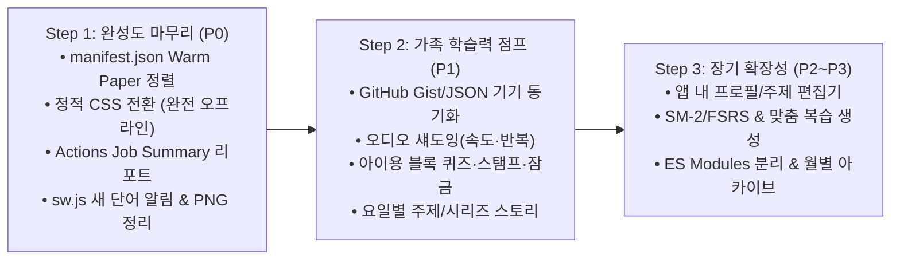

# 🗺️ Language Hub Pro (`voca_data`) 추후 고도화 로드맵

> **작성 기준일**: 2026-11-20  
> **대상 저장소**: `RuneKnight/voca_data` (GitHub Pages 정적 웹앱 · Zero-Build)  
> **목적**: 데이터 파이프라인·기능·디자인·멀티 프로필 1차 고도화 이후, 학습 효과와 가족 사용성, 운영 안정성을 한 단계 더 끌어올리기 위한 차기 개선 항목 정리

---

## 0. 현재 달성 현황 (Completed Baseline)

지금까지 구축 완료된 기반은 다음과 같습니다. 추후 항목은 이 기반 위에 **비파괴적(Non-Breaking)**으로 확장하는 것을 전제로 합니다.

- **데이터 & AI 자동화 파이프라인**: Google Sheets → GitHub Repo JSON 무손실 이관, 2-Track 자동화(GitHub Actions 매일 08:00 KST 자동 생성 + 앱 내 Quick Import), Gemini 3.x 무료 티어 모델(`gemini-3.8-flash` / `gemini-3.5-flash-lite`) 및 자동 폴백.
- **가족 멀티 프로필**: `나(me · EN+DE)`, `와이프(wife · EN A2-B1)`, `아이(kid · EN Pre-A1-A1)` 별도 데이터 디렉토리, `localStorage` 격리, 단일 언어 적응형 UI, 전용 URL(`?profile=...`), 프로필별 주제·볼륨·모델 분리.
- **학습 기능**: 플래시카드/리스트 전환, Fisher-Yates 셔플, EN-DE 병렬 문장 + 단어 칩 팝오버, 퀴즈 3종(객관식+오답노트 / 빈칸 채우기 / 독일어 관사), 기본 SRS, 학습 통계, TTS, JSON 백업/복원.
- **디자인 & 품질 보증**: Warm Paper & Ink 9단계 리디자인(라이트/다크/E-Ink), 모바일 375px 가로 넘침 0px, PWA 기본 등록, Zero-dependency Unit/E2E(Headless Chromium) CI 자동 검증.

---

## 1. 우선순위 한눈에 보기 (Priority Matrix)

| 우선순위 | 구분 | 핵심 항목 | 기대 효과 | 예상 난이도 |
|---|---|---|---|---|
| **P0 (Quick Wins)** | 디자인·운영 | `manifest.json` 팔레트/단축키 정비, 루트 구 스크린샷 정리, Actions 생성 리포트(Job Summary), `sw.js` 새 단어 알림 | 즉각적인 완성도·운영 가시성 상승 | 낮음 |
| **P0 (Quick Wins)** | 성능·PWA | `cdn.tailwindcss.com` 런타임 CDN 제거 → 정적 CSS 전환 | **100% 오프라인 PWA 동작** + 로딩 속도 대폭 개선 | 낮음~중간 |
| **P1 (Core Value)** | 기능·가족 | 기기 간 학습 기록 동기화 (GitHub PAT 기반 Gist/JSON Push·Pull) | PC↔모바일↔태블릿 북마크·SRS 연속 학습 | 중간 |
| **P1 (Core Value)** | 기능·학습 | 오디오 섀도잉/연속 듣기 모드 (속도 조절·반복·보이스 선택) | 출퇴근·산책·아이 듣기 학습 효율 극대화 | 중간 |
| **P1 (Core Value)** | 기능·아이 | 아이(`kid`) 전용 모드: 철자/단어 블록 퀴즈, 칭찬 스탬프, 설정 잠금(PIN) | 초등 아이 자발적 학습 유도 + 오조작 방지 | 중간 |
| **P1 (Core Value)** | 파이프라인 | 요일별 테마 로테이션 & 시리즈 스토리 생성(예: 5일 여행/동화) | 매일 생성 콘텐츠의 지루함 해소·맥락 학습 강화 | 낮음~중간 |
| **P2 (Power)** | 파이프라인 | 학습 기록 연동 "맞춤 복습(Adaptive)" 생성 + 생성 실패 알림 | 틀린 단어의 자연스러운 문장 재등장 + 무중단 운영 | 중간 |
| **P2 (Power)** | 기능·UX | 앱 내 프로필/주제 편집기 & Actions 즉시 실행 트리거 | 코드 편집 없이 모바일에서 주제·생성량 조정 | 중간 |
| **P2 (Power)** | 디자인·UX | 모바일 카드 스와이프 제스처, 프로필별 미세 악센트, E-Ink 폰트 크기 조절 | 모바일·E-Ink 실사용 손맛 및 가독성 향상 | 낮음~중간 |
| **P3 (Scale)** | 아키텍처 | `index.html`(163KB) Zero-Build ES Modules 분리 & 월별 데이터 아카이브 | 장기 데이터 누적(수천 단어)에도 빠른 로딩·쉬운 유지보수 | 중간~높음 |

---

## 2. 영역별 상세 개선 아이디어

### 영역 A. AI 생성 파이프라인 & 콘텐츠 품질

#### A-1. GitHub Actions 생성 리포트 (Job Summary) & 실패 알림 `[P0]`
- **현재 한계**: 매일 08:00 KST 생성이 끝나도 어떤 단어가 추가됐는지 확인하려면 커밋 diff나 앱을 직접 열어야 하며, API 장애 시 놓치기 쉽습니다.
- **개선안**:
  - `scripts/generate-daily.mjs` 종료 시 `$GITHUB_STEP_SUMMARY`에 프로필별 생성 결과(신규 단어 수, 대표 문장 표, 사용 모델, 소요 시간)를 마크다운으로 자동 출력.
  - 워크플로우 실패 시 GitHub Issue 자동 생성 또는 선택적 Webhook(Telegram / Slack / Discord) 알림 연결.

#### A-2. 요일별 주제 로테이션 & 연속 스토리 모드 `[P1]`
- **현재 한계**: `data/profiles.json`에 고정된 단일 `topics` 문자열만 반복 사용되어 장기적으로 패턴이 비슷해질 수 있습니다.
- **개선안**:
  - `daily.weekdayTopics` 옵션 추가 (예: 월=업무/회의, 화=일상/대화, 수=기술/트렌드, 목=여행/문화, 금=취미/건강, 토·일=가벼운 관용 표현).
  - **시리즈 모드**: `와이프` 프로필은 "공항 → 체크인 → 카페 주문 → 쇼핑 → 체크아웃" 5일 여행 시나리오, `아이` 프로필은 "강아지 모험" 5일 미니 스토리처럼 며칠에 걸쳐 이어지는 문장 생성.

#### A-3. 발음 기호(IPA) · 쉬운 발음 힌트 & 메타데이터 일괄 보강 `[P1~P2]`
- **현재 한계**: 기존 Google Sheets에서 이관된 일부 단어는 품사/레벨이 불완전할 수 있고, 영어/독일어 발음 힌트(IPA) 필드가 없습니다.
- **개선안**:
  - 스키마에 선택 필드 `ipa` (발음 기호), `syllables` (음절 구분, 아이 프로필용) 추가.
  - 기존 데이터 중 메타데이터가 빈 항목을 일괄 점검·보강하는 1회성 스크립트(`scripts/enrich-metadata.mjs`) 도입.

#### A-4. 오답·즐겨찾기 연동 "맞춤 복습(Adaptive)" 생성 `[P2]`
- **현재 한계**: 현재 AI 생성은 `word-index.json`의 기존 단어를 무조건 제외하는 단방향 구조입니다.
- **개선안**:
  - 기기 간 동기화(B-1)가 도입되면, 프로필별 `reviewTargets`(오답률 높은 단어·즐겨찾기 단어 2~3개)를 프롬프트에 주입해 **새로운 예문 속에서 복습 단어가 자연스럽게 재등장**하도록 설계.

---

### 영역 B. 학습 기능 & 가족 경험

#### B-1. 기기 간 학습 기록 동기화 (Cross-Device Sync) `[P1]` — 확정 방향: **비공개 GitHub Gist**
- **현재 한계**: 북마크·완료·SRS·학습 통계가 브라우저 `localStorage`에만 저장되어 PC와 휴대폰 간 학습 진도가 공유되지 않습니다.
- **확정 구현 방향 (사용자 선택)**:
  - 메인 레포(`voca_data`) 커밋 로그를 깔끔하게 유지하기 위해 **비공개 GitHub Gist**에 프로필별 진행 상태(`progress-me.json`, `progress-wife.json`, `progress-kid.json`)를 저장.
  - 충돌 방지: `updatedAt` 타임스탬프 + Set 합집합(북마크/완료) + 최근 복습 우선(SRS) 병합 전략 적용.
  - "자동 동기화(옵션)" 또는 상단 상태바 원클릭 Sync 버튼 제공.

#### B-2. 오디오 섀도잉 & 듣기 집중 플레이어 `[P1]`
- **현재 한계**: 현재 TTS는 단일 항목 클릭 재생 위주이며, 재생 속도·반복 간격·음성 선택 옵션이 없습니다.
- **개선안**:
  - **섀도잉 플레이어**: "원어 문장 재생 → 무음 대기(2~3초, 따라 말하기) → 한국어 뜻 표시/읽기 → 원어 1회 재재생" 자동 루프.
  - **TTS 세부 설정**: 속도(`0.7x / 0.85x / 1.0x / 1.15x`), 영어 미국/영국 보이스 및 독일어 고품질 보이스 선택, 화면 꺼짐 방지(Wake Lock API).
  - **발음 체크(선택)**: Web Speech Recognition API(`webkitSpeechRecognition`)를 활용한 무료 브라우저 내장 말하기 일치율 테스트.

#### B-3. 아이(`kid`) 프로필 특화 기능 `[P1]`
- **현재 한계**: 아이 프로필도 성인과 동일한 객관식·카드 중심 UI로 제공됩니다.
- **개선안**:
  - **단어 블록 조립 & 철자 맞추기 퀴즈**: 셔플된 단어 타일(또는 알파벳 타일)을 순서대로 눌러 문장/단어를 완성하는 직관적 게임형 퀴즈.
  - **오늘의 스탬프 & 목표 달성**: "오늘 새 단어 3개 완료" 시 달력에 스탬프 적립(과도한 게이미피케이션 없이 따뜻한 종이 노트 감성 유지).
  - **어린이 안전 잠금(Simple Lock)**: 설정/Quick Import/데이터 초기화 버튼 및 프로필 변경 드롭다운을 간단한 4자리 PIN으로 잠글 수 있는 옵션.

#### B-4. SRS 고도화 & 퀴즈 유형 확장 `[P2]`
- **현재 한계**: 현재 SRS는 기본 간격 모델이며, 퀴즈는 3종(객관식/빈칸/독일어 관사)입니다.
- **개선안**:
  - **SM-2 / FSRS 알고리즘 도입**: 카드 뒤집기 후 `다시(Again) / 어려움(Hard) / 보통(Good) / 쉬움(Easy)` 4단계 평가로 개인별 망각곡선 최적화.
  - **받아쓰기(Dictation) 퀴즈**: TTS 음성을 듣고 핵심 단어/문장을 타이핑하는 리스닝 강화 모드.
  - **"오늘 복습" 전용 집중 세션**: 헤더 필터와 별개로 오늘 복습 예정(Due) 카드만 순서대로 소진하는 몰입형 카드 덱 UI.

#### B-5. 앱 내 프로필/주제 관리 & 즉시 생성 버튼 `[P2]`
- **현재 한계**: 주제나 생성량을 바꾸려면 `data/profiles.json`을 직접 편집하고 커밋해야 합니다.
- **개선안**:
  - 설정 모달에 **프로필 관리 탭** 추가 → `topics`, `pairCount`, `levels`, `model`을 수정해 GitHub Contents API로 `data/profiles.json`에 바로 커밋.
  - GitHub Actions `workflow_dispatch` API를 호출하는 **"지금 오늘 단어 생성하기"** 버튼 추가 (PAT에 `actions: write` 권한 선택 시 활성화).

---

### 영역 C. 디자인 & UX 디테일 고도화

#### C-1. PWA 매니페스트 정합성 & 저장소 정리 `[P0]`
- **현재 상태 점검 결과**:
  - `manifest.json`의 `background_color`(`#f8fafc`)와 `theme_color`(`#0f172a`)가 리디자인 전 Slate 색상으로 남아 있습니다 → Warm Paper & Ink(`#F7F4EE`, `#161513`)로 일치시키고, PWA 앱 아이콘 길게 누르기 `shortcuts`(`나`, `와이프`, `아이`)를 추가하면 가족 공유가 더욱 편리해집니다.
  - 저장소 루트에 초기 디자인 점검용 스크린샷 5장(`desktop.png`, `mobile.png`, `mobile_flipped.png`, `mobile_quiz.png`, `mobile_sentence.png`, 총 ~1MB)이 남아 있습니다 → 정리하거나 `docs/screenshots/`로 정리해 레포를 깔끔하게 유지.

#### C-2. 오프라인 100% 지원: Tailwind Play CDN → 정적 CSS 전환 `[P0]`
- **현재 한계**: `index.html`이 런타임에 `https://cdn.tailwindcss.com`을 불러오므로, 비행기/지하철 오프라인 PWA 상태나 느린 모바일 망에서는 스타일이 깨지거나 초기 깜빡임(FOUC)이 발생할 수 있습니다.
- **개선안**:
  - GitHub Actions CI/배포 단계(또는 로컬 1회 빌드)에서 사용된 유틸리티만 추출한 경량 정적 `assets/app.css`(약 15~25KB gzip)를 생성해 `sw.js`에 프리캐시.
  - Zero-Build 원칙을 유지하려면 `tailwindcss` 단독 CLI 바이너리나 순수 CSS 유틸리티 파일로 대체 → **완전 오프라인 100% 렌더링 + 초기 로딩 속도 대폭 단축**.

#### C-3. 프로필별 미세 악센트 & 아이용 큰 글씨 프리셋 `[P2]`
- **개선안**:
  - Warm Paper & Ink 기본 톤은 유지하면서 프로필별 미묘한 잉크 악센트 컬러(예: `나`=딥 슬레이트, `와이프`=세이지 그린, `아이`=웜 오커)를 헤더 필·진행률 바에 적용해 "지금 누구의 단어장인지" 0.1초 만에 인지 가능하게 개선.
  - 아이 프로필 활성화 시 자동으로 한 단계 넉넉한 글자 크기와 터치 타겟(최소 48px) 적용.

#### C-4. 모바일 스와이프 제스처 & E-Ink 리딩 편의 강화 `[P2]`
- **개선안**:
  - **모바일 플래시카드 제스처**: 카드 좌/우 스와이프로 `다시 보기` / `완료 처리`, 위/아래 스와이프로 다음 카드 이동.
  - **E-Ink 전용 UX**: 폰트 크기 3단계(`S / M / L`) 조절, 스크롤 대신 고정 `이전 / 다음` 페이지네이션 버튼, 고대비 굵은 테두리 유지.

---

### 영역 D. 아키텍처 · 성능 · 운영 안정성

#### D-1. `index.html` Zero-Build ES Modules 분리 `[P3]`
- **현재 한계**: `index.html`이 약 163KB(3,400줄+) 단일 파일로 커져 기능 추가 시 탐색·리뷰·충돌 관리 비용이 증가하고 있습니다.
- **개선안**:
  - 번들러/빌드 도구 없이 브라우저 네이티브 `<script type="module">`로 자연스럽게 분리:
    - `js/state.js` (전역 상태 & 프로필 관리)
    - `js/storage.js` (`localStorage` · 동기화 레이어)
    - `js/adapter.js` (GitHub JSON / Sheets 로더)
    - `js/tts.js` (음성/섀도잉 엔진)
    - `js/views/cards.js`, `js/views/sentences.js`, `js/views/quiz.js`, `js/views/modals.js`
  - Unit 테스트에서 브라우저 DOM 없이도 순수 JS 모듈을 직접 import해 테스트 커버리지 확대 가능.

#### D-2. 장기 데이터 누적 대비 월별 아카이브 & 지연 로딩 `[P3]`
- **현재 한계**: 매일 3개 프로필 데이터가 쌓이면 1년 후 수천 개 항목(`2~3MB+`)이 단일 JSON에 누적되어 초기 파싱·검색 비용이 커집니다.
- **개선안**:
  - `data/manifest.json`에 월별 청크 목록(`chunks: ["2026-11", "2026-12", ...]`)을 기록하고, 초기 진입 시 최근 60~90일 데이터만 우선 로드(즉시 화면 표시) + 과거 데이터는 검색/스크롤 시 백그라운드 병합.

#### D-3. Service Worker (`sw.js`) 갱신 감지 & 프로필별 프리캐시 `[P0~P1]`
- **현재 한계**: `sw.js`가 Stale-While-Revalidate로 새 JSON을 받아와도 현재 열린 탭에 알림을 주지 않아, 사용자가 수동 새로고침을 해야 오늘 추가된 단어가 보입니다.
- **개선안**:
  - 백그라운드 fetch로 `manifest.json`의 `generatedAt`이 갱신되면 클라이언트에 `postMessage`를 보내 상단에 **"오늘의 새 단어가 도착했습니다 · 업데이트"** 배너 표시.
  - 현재 활성 프로필의 JSON 파일만 우선 캐싱하여 모바일 저장 공간 절약.

---

## 3. 추천 진행 순서 (3단계 실행 플랜)

한 번에 모든 것을 하기보다, 체감 효용이 큰 순서대로 3단계로 나누어 진행하는 것을 권장합니다.

1. **~~Step 1 (가벼운 마무리 & 즉시 체감)~~ — ✅ 완료 (2026-11-20)**: 오프라인 100% 정적 CSS(`assets/app.css`), Warm Paper PWA(`manifest.json`/`icon.svg`), Actions Job Summary 리포트, `sw.js` 새 단어 도착 알림 배너, 구 루트 PNG 정리 완료.
2. **~~Step 2 (가족 학습력 점프)~~ — ✅ 완료 (2026-11-20)**: 비공개 GitHub Gist 기기 간 병합 동기화, 오디오 섀도잉 플레이어(속도·대기·반복·보이스·Wake Lock), 아이 전용 모드(블록 조립 퀴즈·일일 목표 스탬프·4자리 PIN 안전 잠금), 요일별 주제 로테이션 & 연속 스토리 생성 완료.
3. **~~Step 3 (장기 유지보수 & 고도화)~~ — ✅ 완료 (2026-11-20)**: Zero-Build ES Modules(`js/srs.js`, `js/sync.js`, `js/archive.js`, `js/github-ops.js`) 분리, SM-2 4단계 평가 + 오답·즐겨찾기 연동 맞춤 복습 AI 생성, 앱 내 프로필/주제 편집기 & Actions 즉시 생성 트리거, 월별 아카이브 분할·지연 로딩 완료.
